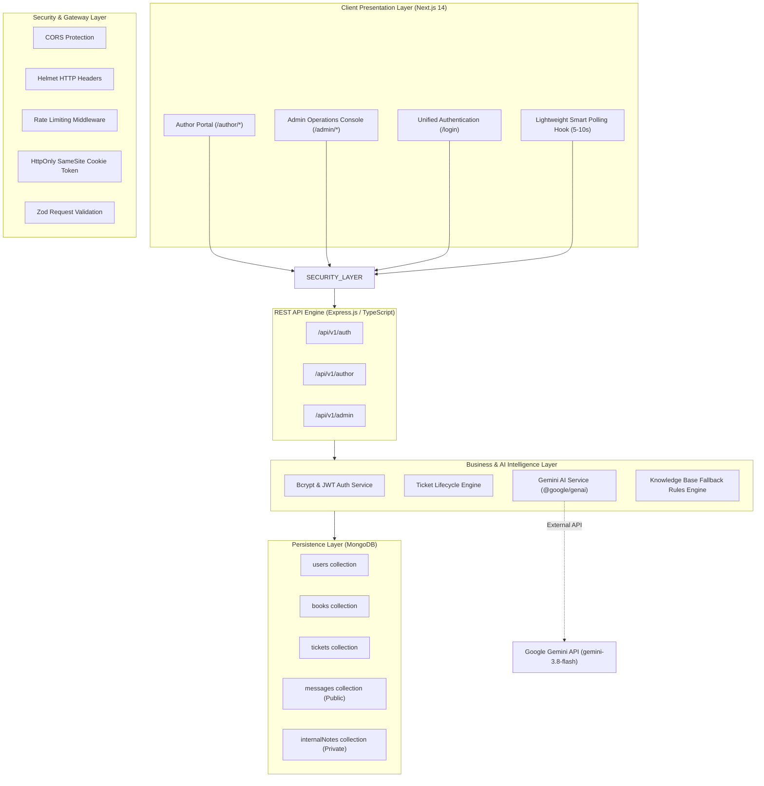
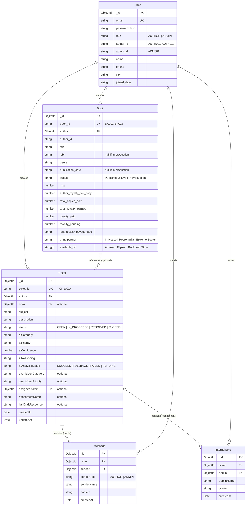
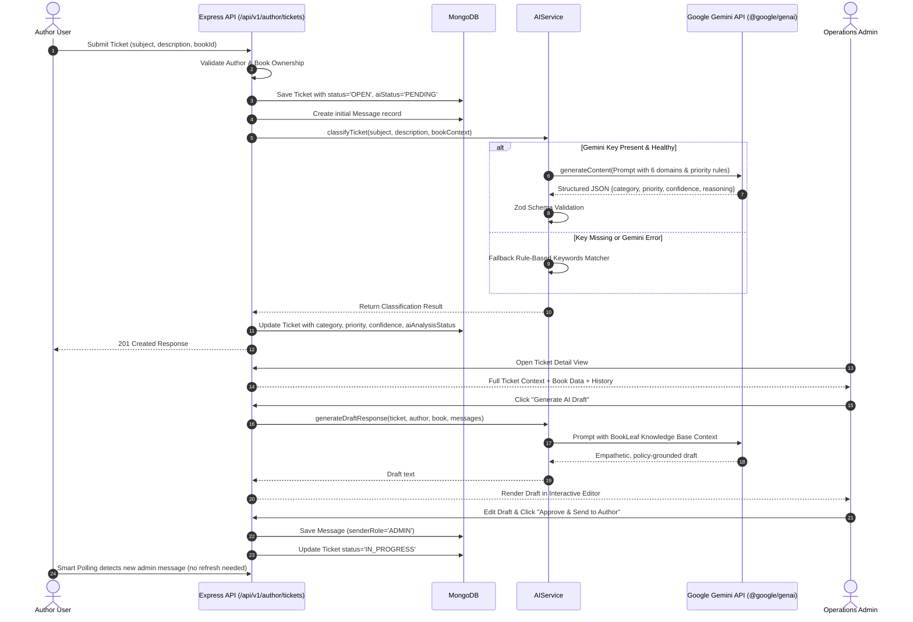

# BookLeaf Publishing — Architecture & Technical Design

## 1. Executive Architecture Summary

The **BookLeaf Author Support & Communication Portal** is an enterprise-grade full-stack web application architected to streamline author communications, publication tracking, royalty reconciliation, and operational query management at scale. The platform features strict role-based access control (RBAC), multi-tenant author data isolation, an intelligent Google Gemini AI integration engine with deterministic fallback rules, and near-real-time synchronization between authors and operations personnel.

---

## 2. Technology Stack & Rationale

| Layer | Technology | Architectural Rationale |
| :--- | :--- | :--- |
| **Frontend Framework** | **Next.js 14 (App Router)** | Server & Client components, robust routing, optimized bundle size, fast rendering, strict TypeScript compliance. |
| **Styling & Design System** | **Tailwind CSS** | Editorial publishing aesthetic, responsive design, consistent design tokens, accessible focus states, zero CSS bloat. |
| **Data Visualization** | **Recharts** | Lightweight, responsive SVG bar charts rendering domain distribution without client-side lag. |
| **Icons & Micro-interactions** | **Lucide React** | Consistent, tree-shakeable iconography. |
| **Backend Server** | **Express.js with TypeScript** | Clean decoupled REST API, versioned endpoints (`/api/v1`), explicit middleware piping, centralized error handling. |
| **Schema Validation** | **Zod** | Strict runtime request body and query validation, ensuring no malformed or injected data enters controllers. |
| **Database & ODM** | **MongoDB & Mongoose** | Flexible document modeling for complex books, royalty figures, conversation threads, and decoupled internal notes. |
| **Authentication & RBAC** | **JWT in HttpOnly Cookies + bcryptjs** | Secure against XSS token theft, strict role validation (`AUTHOR` vs `ADMIN`), and author ownership checks. |
| **AI Intelligence Engine** | **Google Gemini (`@google/genai`)** | Official current SDK, structured JSON output validation, grounded response drafting, and token-conscious context prompts. |

---

## 3. Data Schema & Collection Relationships

---

## 4. Multi-Tenant Data Isolation & Security Architecture

1. **Strict Ownership Verification**:
   - When an author requests `/api/v1/author/dashboard`, `/api/v1/author/books`, or `/api/v1/author/tickets`, the query is hard-filtered by `author: req.user._id`.
   - When raising a ticket linked to a `bookId`, the backend validates that `Book.findOne({ _id: bookId, author: req.user._id })` exists. If an author attempts to select another author's book, the API immediately halts execution with `403 Forbidden`.
   
2. **Segregation of Internal Notes**:
   - Internal notes are stored in a dedicated `InternalNote` Mongoose collection.
   - Author-facing endpoints (`/api/v1/author/tickets/:id`) do not query or join the `InternalNote` collection under any circumstances.
   - Internal notes are only queryable via the admin endpoint protected by `requireRole('ADMIN')`.

3. **HTTP Cookie Security & CSRF Defense**:
   - JWT tokens are issued inside HttpOnly, SameSite cookies with a 7-day expiration.
   - Cross-Site Request Forgery is mitigated by restrictive SameSite attributes, CORS origin whitelisting (`env.FRONTEND_URL`), and standard JSON Content-Type validation.

---

## 5. AI Integration Pipeline

---

## 6. Real-Time Updates & Smart Polling

Rather than introducing heavy, stateful WebSocket connection overhead for an author support dashboard, the platform employs a high-efficiency **Smart Polling Architecture**:
- Ticket conversation threads and dashboard queues poll every **5 to 10 seconds** (configured at 6s).
- The custom React hook `usePolling` listens to the HTML5 `visibilitychange` API:
  * When an author or admin switches tabs or minimizes the browser window (`document.hidden === true`), polling is **completely suspended**, eliminating unnecessary network requests and server CPU usage.
  * When the tab becomes active again, polling triggers an immediate refresh and resumes the interval.
  * When components unmount, the timer is cleanly deregistered.
